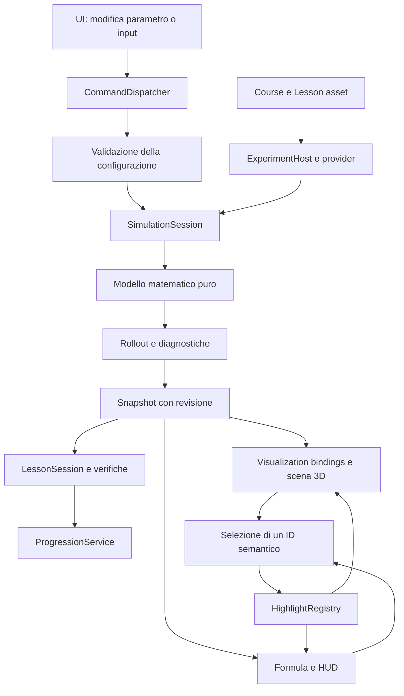

# Optimal Control — architettura proposta

Data: 9 ottobre 2026. Questo documento definisce responsabilità e contratti per l'implementazione successiva. Le classi, gli asset e le scene descritti non sono ancora presenti nel progetto.

## Vincoli e decisioni principali

Il workspace è un template Unity `6000.3.8f1` con URP `17.3.0`; contiene una `SampleScene` e nessuna logica applicativa. L'analisi dei file esistenti è riassunta nella [visione](OPTCON_PROJECT_VISION.md). I contenuti derivano dalle 18 lezioni del [curriculum](OPTCON_CURRICULUM.md).

Le decisioni iniziali sono:

- Matematica e simulazione in C# puro, con valori `double`, senza dipendenze da GameObject, Transform, UI o fisica Unity.
- Dati editoriali e configurazioni in ScriptableObject; valori correnti e progressione in oggetti runtime separati.
- Snapshot versionati condivisi da rappresentazione 3D, HUD, grafici e logica didattica.
- Modelli, algoritmi e scenari forniti attraverso provider componibili; il CourseManager naviga dati e ID senza conoscere i capitoli.
- Piccolo numero di scene di infrastruttura e prefab/scenari riutilizzabili, con una sola lezione attiva.
- UI Toolkit proposto per i pannelli; il rendering delle formule è un'interfaccia sostituibile da validare nel prototipo.
- Nessun nuovo pacchetto pesante iniziale. LineRenderer, mesh procedurali, primitive e materiali URP coprono la prima produzione.

## Livelli e dipendenze

| Livello | Responsabilità | Classi/contratti principali proposti | Dipendenze ammesse |
| --- | --- | --- | --- |
| Mathematical Model | Dinamica, costi, vincoli, derivate e quantità matematiche | `IDiscreteDynamics`, `ICostModel`, `IConstraintModel`, `ModelDimensions`, `NumericVector`, `NumericMatrix` | Libreria standard C# |
| Simulation | Rollout, storie temporali/iterative, confronti, diagnostiche | `RolloutEngine`, `SimulationSession`, `SimulationSnapshot`, `TrajectoryHistory`, `ComparisonSnapshot` | Core matematico |
| Data/configuration | Corso, lezioni, formule, parametri, preset e provenienza | `CourseDefinition`, `ChapterDefinition`, `LessonDefinition`, `ExperimentDefinition`, `FormulaDefinition` | Unity per la serializzazione; Core/Simulation per i descrittori runtime |
| Educational | Obiettivi, passaggi guidati, osservazioni e verifiche | `LessonSession`, `LessonStepDefinition`, `ILessonConditionEvaluator` | Snapshot e definizioni della lezione |
| Course progression | Navigazione, prerequisiti, salvataggio di completamenti | `CourseManager`, `ProgressionService`, `IProgressStore` | Catalogo e ID; nessuna conoscenza della matematica delle singole lezioni |
| Visualization | Proiezione in coordinate visibili, primitive, layer e selezione | `VisualizationBinding`, `StateProjection`, renderer e `HighlightRegistry` | Snapshot + Unity/URP |
| UI/HUD | Comandi, formula, valori, timeline e parametri | `LessonHudPresenter`, `FormulaPresenter`, `ParameterPanelPresenter`, `TimelinePresenter` | Snapshot, descrittori e bus dei comandi |
| Application | Composition root, scene e lifecycle | `AppBootstrap`, `LessonLoader`, `ExperimentHost`, `PlaybackController` | Collega i livelli attraverso i contratti |

Il codice matematico non include stringhe di formule destinate alla UI. Le formule editoriali non vengono interpretate come codice per calcolare la dinamica: i valori provengono dal modello, con binding dichiarati. Questo evita due implementazioni concorrenti della stessa legge.

Assembly Definition proposte, da creare gradualmente:

```text
OptCon.Core          [noEngineReferences; matematica]
OptCon.Simulation    [noEngineReferences; dipende da Core]
OptCon.Content      [asset Unity → descrittori runtime]
OptCon.Presentation [3D + UI; dipende da Content/Simulation]
OptCon.Application  [composizione, lezioni e corso]
OptCon.Editor       [Editor only; authoring e validazione]
OptCon.Tests        [assembly di test separati per Core e runtime]
```

Non sono necessarie sette implementazioni complete per avviare il slice: il confine puro di Core/Simulation, gli asset essenziali e un host sottile sono sufficienti. Gli assembly aggiuntivi vengono separati quando c'è codice da collocarvi.

## Contratti matematici

| Contratto | Input/risultato concettuale | Regola |
| --- | --- | --- |
| `IDiscreteDynamics` | `Evaluate(t, x_t, u_t, parameters) → x_next` | Dimensioni e parametri validati; funzione deterministica per il prototipo |
| `ICostModel` | `EvaluateStage(t,x,u)` e `EvaluateTerminal(x_T)` → totale e contributi nominati | Il totale coincide con la somma dei contributi; terminale contato una sola volta |
| `IConstraintModel` | `Evaluate(scope,x,u) → residuals` | Ogni componente dichiara tipo, unità, dominio temporale e tolleranza |
| `IDifferentiableDynamics` | Jacobiani `A_t`, `B_t` | Capability aggiunta per linearizzazione/adjoint, non richiesta a ogni modello |
| `IObjectiveFunction` | `Value(z)`, eventuali `Gradient(z)`, `Hessian(z)` | Capability di ottimizzazione aggiunta per il capitolo 2 |
| `IProjectionOperator` | Proiezione su uno specifico insieme | Disponibile solo se il modello sa calcolarla; niente proiezioni geometriche finte |
| `IIterationAlgorithm` | Configurazione/candidato → un'iterazione con diagnostiche | Storico distinto dal rollout fisico; algoritmi introdotti dopo il slice |

Per le dimensioni iniziali bastano vettori e matrici piccoli con operazioni esplicite. Per Newton/SQP usare la soluzione di sistemi lineari, non formare inversi numerici. L'estensione a problemi grandi richiederà un backend numerico separato, senza cambiare HUD o curriculum.

Un `ModelDefinition` concreto è un asset/provider Unity che valida il proprio schema e crea il corrispondente modello C# puro. Un `AlgorithmDefinition` fornisce analogamente una strategia. `ExperimentDefinition` li referenzia direttamente: aggiungere un provider per un nuovo sistema non introduce una `switch(chapterId)`.

Le funzioni condividono una convenzione: il Core usa Jacobiani standard (`A`: `n×n`, `B`: `n×m`); i dati delle formule espongono anche la notazione del corso `A=∇₁fᵀ`, `B=∇₂fᵀ`. La conversione è esplicita e verificata, specialmente nelle KKT.

## Sessione, snapshot e storie

`SimulationSession` possiede configurazione runtime, modello, sequenza degli input, revisioni, storia e cursori. Uno snapshot pubblico è immutabile dal punto di vista dei consumer; nessuna vista può alterarne array o dizionari.

```text
SimulationSnapshot
  revisionId, experimentId, modelVersion
  timestep t, horizon T, discretizationStep δ, physicalTime τ_t
  iteration k [opzionale]
  currentState x_t
  controlRequested u_t / controlApplied u_t [se c'è un attuatore]
  nextState x_(t+1) [assente al terminale]
  referenceState/referenceControl [se disponibili]
  stageCost + componenti [assente al terminale]
  cumulativeStageCost, terminalCost, totalTrajectoryCost
  constraints/residuals, derivativeDiagnostics [opzionali]
  metrics tipizzate + stato di validità
```

Le metriche hanno ID semantici, tipo scalare/vettore/matrice, dimensione, unità e validità (`Available`, `NotApplicable`, `Invalid`). Esempi: `state.current`, `state.next`, `input.applied`, `cost.stage`, `cost.terminal`, `cost.total`, `dynamics.residual`, `linearization.error`, `gradient.objective`, `kkt.stationarity.input`. Ogni provider dichiara quali produce. La validazione dei binding scopre un termine non supportato prima dell'apertura della lezione.

All'istante `j`, il cumulativo degli stage è `C_j=Σ_(i=0)^(j−1)ℓ_i`; al terminale si aggiunge `ℓ_T` per ottenere il costo totale. In `t=T` non ci sono `u_T`, `x_(T+1)` o stage cost: HUD e binding mostrano «non applicabile». Un terminal cost può essere mostrato come previsione dell'intero rollout mentre il cursore è altrove, con uno scope dichiarato `Terminal`.

`TrajectoryHistory` memorizza `T+1` stati e `T` input/transizioni. `IterationHistory` contiene le revisioni dei candidati, gradienti, moltiplicatori, direzioni e tentativi di line search. Una lezione di controllo ottimo può selezionare `(k,t)` senza mescolare i due indici.

### Riproduzione, modifica e rewind

Il primo prototipo precalcola un rollout piccolo e lo riproduce. Il clock di presentazione usa i frame per spostare il cursore tra campioni; il timestep matematico non dipende dal framerate o da `FixedUpdate`. Il ritorno indietro seleziona dati salvati: non integra la dinamica con tempo negativo.

Un comando su un input esplicita se modifica solo `u_t` o tutta la coda `u_t,…,u_(T−1)`. La sessione ricalcola dal primo campione interessato, incrementa la revisione e pubblica un risultato completo. Cambiare stato iniziale o parametri della dinamica ricalcola l'intero rollout; cambiare solo pesi può riutilizzare stati e ricalcolare diagnostiche/costi, sotto una nuova revisione.

Cambiare `T` o `δ` è una modifica del problema; cambiare velocità di playback è una modifica della presentazione. Il prototipo usa pose dei campioni esatti. Un'eventuale interpolazione futura deve dichiarare che il corpo è interpolato e mantenere gli indicatori dei campioni coerenti.

### Compare e fallimenti numerici

`ComparisonSnapshot` conserva copie di parametri, modello/versione, stato iniziale, input, orizzonte, passo e risultati di A. B continua a evolvere come sessione corrente. Le etichette indicano A/B e le differenze; confronti con orizzonti diversi mostrano entrambi gli orizzonti e solo un intervallo temporale comune per i tracciati sovrapposti. Se cambiano i pesi, i costi appartengono a obiettivi diversi: per confrontare le decisioni si può valutarle anche sotto una configurazione di costo comune, identificata esplicitamente.

I risultati `NaN`, infiniti, fuori dominio o i sistemi singolari producono uno stato di errore della revisione candidata. La vista mantiene accessibile l'ultimo risultato valido e segnala la revisione fallita; non sostituisce residui con zero, non altera silenziosamente i parametri e non etichetta la candidatura come convergente.

Un modello con saturazione registra input richiesto e applicato; se il problema originale è senza saturazione, il renderer non può aggiungerla. Disattivare la visualizzazione di un vincolo e rimuoverlo dal modello sono due comandi diversi.

## Flusso dati e comandi



Una notifica di snapshot completo aggiorna tutti i presenter. Operazioni asincrone future portano un `revisionId`: il risultato di una revisione superata viene scartato. Il bootstrap possiede servizi e lifetime; lo scaricamento della lezione annulla lavori pendenti, rimuove subscription, highlight e oggetti della sessione.

La selezione è uno stato UI comune (`SelectedSemanticTarget`), non una seconda copia della simulazione. Può aggiornare highlight senza ricalcolare la dinamica.

## Dati editoriali: ScriptableObject e descrittori

| Asset/dato | Campi essenziali | Cosa non contiene |
| --- | --- | --- |
| `CourseDefinition` | ID/versione, titolo, lista ordinata di capitoli | Switch sui capitoli o valori live |
| `ChapterDefinition` | ID, titolo, sommario, fonti, lezioni ordinate | Logica del loader |
| `LessonDefinition` | ID, obiettivi, prerequisiti, esperimento, formule, passi, criteri di completamento, scene reference | Codice specifico in CourseManager |
| `ExperimentDefinition` | Provider del modello/costo/vincoli, eventuale algoritmo, preset, parametri, projection, prefab/scenario | Stato della sessione corrente |
| `FormulaDefinition` | ID/versione, espressione, descrizione, termini, ipotesi, fonti, note di rettifica | Calcolo numerico alternativo |
| `FormulaTermDefinition` | ID locale, simbolo, nome, significato, dimensione/unità, value binding, scope, highlight binding | Valore corrente serializzato nell'asset |
| `VisualizationDefinition` | Layer, stile, scale visive, binding e projection | Vincoli o costi ricalcolati nel renderer |
| `LessonParameterDefinition` | ID, tipo/unità, default/range/step, descrizione, target del modello, policy di ricalcolo | Seconda copia indipendente del parametro |
| `SourceDocumentDefinition` / `SourceReference` | Source ID, percorso, hash/versione, pagine fisiche, slide/sezione, rettifica/adattamento | Conversione automatica non revisionata da PDF a codice |
| `LessonStepDefinition` | Istruzione, formula focus, layer attivi, controlli abilitati e condizioni | Dipendenza dal numero della scena |

`FormulaTermDefinition`, `SourceReference` e definizioni di parametri/passaggi possono iniziare come classi serializzabili incorporate nell'asset proprietario. Si promuovono ad asset autonomi se serve il riuso. Course, Chapter, Lesson, Experiment e Formula sono i primi ScriptableObject consigliati.

Alla creazione della sessione gli asset vengono convertiti in descrittori/configurazioni runtime. Cambiare uno slider non sporca gli asset e non modifica il preset originale. La validazione di un parametro comprende sia il range UI sia le invarianti del modello (`m>0`, `l>0`, matrici simmetriche e pesi ammissibili, dimensioni corrette).

## Sistema delle formule

### Identità e binding

Una formula ha un ID stabile, per esempio `dynamics.discrete`, `cost.additive`, `optimization.newton` o `oc.kkt.input-stationarity`. Le lezioni referenziano l'asset condiviso e possono aggiungere una spiegazione contestuale; non copiano la stessa espressione nei MonoBehaviour.

Ogni termine usa un `ValueBinding` tipizzato: chiave della metrica, eventuale componente/indice, scope (`CurrentTimestep`, `NextTimestep`, `Terminal`, `CurrentIteration`) e formattazione. Un `HighlightBinding` usa un ruolo semantico e lo stesso scope; non un path di GameObject dipendente dalla scena.

| Formula `dynamics.discrete` | Binding valore | Target visivo |
| --- | --- | --- |
| `x_t` | `state.current`, `CurrentTimestep` | Marker stato e corpo al timestep selezionato |
| `u_t` | `input.applied`, `CurrentTimestep` | Controllo sull'arco corrente; coppia del pendolo |
| `f_t` | Descrittore della dinamica e parametri della revisione | Arco di transizione e previsione |
| `x_(t+1)` | `state.next`, `NextTimestep` | Ghost e marker del prossimo campione |
| `ℓ_t(x_t,u_t)` | `cost.stage`, `CurrentTimestep` | Barra/contributi del costo corrente |
| `ℓ_T(x_T)` | `cost.terminal`, `Terminal` | Marker finale e contributo terminale |

Le due righe dei costi appartengono alla formula `cost.additive`; sono qui mostrate per chiarire il riuso degli stessi target temporali.

`FormulaBindingResolver` risolve il dato dal medesimo snapshot; `FormulaPresenter` formatta simbolo, valore e spiegazione; `HighlightRegistry` risolve il target nella scena. Un oggetto può avere più rappresentazioni dello stesso ruolo (corpo, punto nel piano di fase, nodo temporale). Se il layer è nascosto, il presenter propone di mostrarlo o spiega il target senza creare oggetti scollegati.

### Rendering e authoring

Il slice usa espressione Unicode leggibile e una riga/elenco di termini selezionabili. La selezione del simbolo nella lista evidenzia il relativo oggetto e mostra valori/unità; non richiede un parser LaTeX. L'asset conserva anche una trascrizione sorgente per revisione matematica.

`IFormulaView` consente di introdurre successivamente un layout strutturato con somma, indici, frazioni e matrici. Il layout complesso e l'hit testing inline vanno validati prima di produrre tutte le KKT. Un eventuale renderer specializzato è una decisione successiva, dopo un prototipo con simboli reali del corso e senza cambiare binding o modello.

Non è previsto `eval()` di stringhe matematiche, reflection arbitraria o formule hardcoded in molti MonoBehaviour. La correttezza deriva dai provider matematici e dai controlli di equivalenza, non dall'aspetto dell'espressione.

## Sistema di visualizzazione

| Componente comune | Dati letti | Responsabilità |
| --- | --- | --- |
| `TrajectoryRenderer` | Serie di punti da `StateProjection`, stile/layer | Linea, tratteggio, spessore e selezione; stesso componente per tutti i capitoli |
| `VectorRenderer` | Origine, direzione proiettata, magnitudine/unità | Freccia e scala grafica dichiarata; renderer curvo per coppie |
| `PointMarker` / `StateMarker` | Stato/campione, ruolo e label | Stato corrente, passato, ghost, nominale e finale |
| `TargetVisualizer` | Riferimento + projection | Target fisico o nello spazio delle decisioni |
| `TimestepVisualizer` | T, cursore e serie | Catena di nodi/archetti con input e costi |
| `CostContributionVisualizer` | Stage/terminal e componenti | Barre, intensità e grafico cumulativo |
| `ConstraintRegionVisualizer` | Funzione/residui + dominio di una sezione | Regione, bordo, marcatori di violazione e indicazione della risoluzione grafica |
| `CostSurfaceVisualizer` | Campioni di `IObjectiveFunction` | Mesh, livelli e scala dell'altezza; aggiorna al cambio parametri |
| `GradientVisualizer` | Gradiente/direzione forniti dalla matematica | Usa VectorRenderer nello spazio delle decisioni |
| `TangentSpaceVisualizer` | Base tangente/Jacobiani | Piano o direzioni in una sezione dichiarata |
| `ComparisonTrajectoryRenderer` | A/B e stile | Composizione di TrajectoryRenderer, senza un solver proprio |
| `AdjointVisualizer` | Costate e residui per timestep | Catena backward e collegamenti ai termini KKT |
| `LayerController` / `HighlightRegistry` | Definizioni e ID semantici | Visibilità e selezione coerenti tra formule, grafici e mondo |

`StateProjection` converte componenti matematiche in coordinate Unity; conversione a `float` solo al confine di rendering. Le proiezioni dichiarano assi/unità e componenti omesse. Nel slice il corpo usa `θ` per la posa, il piano di fase usa `(θ,ω)` e la timeline usa `t`: i tre oggetti leggono lo stesso stato.

Nel manifold delle traiettorie, per un esempio scalare a un passo si può disegnare esattamente `x₁=f₀(x₀,u₀)` nello spazio `(u₀,x₁)`. Per un sistema grande una sezione/proiezione non viene presentata come la geometria completa. Il modello conserva tutte le dimensioni e verifica i residui completi.

Regioni e superfici sono campionate dal modello, con cache invalidata dalla revisione dei parametri. La mesh è una visualizzazione approssimata: il valore analitico/numerico del vincolo decide l'ammissibilità. Colori, tratti ed etichette codificano i ruoli secondo la [visione](OPTCON_PROJECT_VISION.md).

## Scene e lifecycle

| Scena proposta | Contenuto | Lifecycle |
| --- | --- | --- |
| `Bootstrap` | Composition root, course asset, servizi, root del HUD | Persistente durante la sessione; unico proprietario dei servizi |
| `MainMenu` | Navigazione Course → Chapter → Lesson e progresso | Caricata additivamente dopo Bootstrap; scaricata entrando in una lezione |
| `LessonWorkspace` | Camera, luce URP, spazio/griglia di base e host dello scenario | Caricata additivamente; ospita un prefab d'esperimento alla volta |
| Eventuali workspace specialistici | Layout necessari a concetti incompatibili con il workspace comune | Referenziati dal LessonDefinition e caricati dallo stesso loader |

`LessonLoader` legge `LessonDefinition.SceneReference` e `ExperimentDefinition.ScenarioPrefab`. I riferimenti di scena diventano percorsi verificati nei Build Settings mediante authoring/editor; nessun nome scena hardcoded per capitolo. Aggiungere una lezione con lo stesso workspace richiede solo nuovi dati/prefab.

All'apertura: risolvere prerequisiti, caricare workspace, creare modello/configurazione, creare sessione, comporre visualizzazioni/HUD e avviare il primo passo guidato. Alla chiusura: salvare progressi, fermare playback/calcoli, staccare subscription, distruggere scenario e scaricare la scena. Tornare al menu e ripetere l'apertura non deve duplicare listener, servizi o oggetti.

La `SampleScene` e gli asset del template restano intatti in questa fase documentale; nel piano futuro si riutilizzano gli asset URP pertinenti. Non serve una scena con tutti i capitoli né una scena per ogni pagina.

## UI, logica educativa e progressione

`LessonHudPresenter` compone titolo, spiegazione, pannello formula, variabili, parametri, timeline, controlli e legenda. I pannelli sono collassabili; la camera e la griglia tengono conto dell'area viewport libera. UI e picking nel mondo convergono sugli stessi ID semantici, con scorciatoie per tastiera e focus leggibile.

Un `LessonSession` legge passi ordinati e condizioni dichiarate. I valutatori sono piccoli provider (azione eseguita, osservazione di un residuo, confronto effettuato, risposta concettuale); non incorporano l'intera lezione in uno script. Il tutorial può abilitare layer/controlli senza modificare il modello sottostante. Completare un esperimento avanzato non completa automaticamente altre lezioni che usa come anteprima.

`CourseManager` risolve catalogo, lezione scelta e ritorno al menu. `ProgressionService` valuta prerequisiti attraverso ID; consente esplorazione con indicazione dei prerequisiti mancanti. `IProgressStore` salva una versione di schema con `courseId`, `lessonId`, completamenti e preferenze in un file applicativo. Un nuovo ordine nel corso non cambia l'identità delle lezioni; le migrazioni riguardano lo schema, non indici di array.

I controlli per i solver includeranno pulsante «una iterazione», `k`, tolleranze e diagnostiche. Nelle lezioni di controllo questo pannello è separato dalla timeline `t`. Per le KKT si mostrano separatamente ammissibilità primal, ammissibilità dual, stationarity e complementarità: un solo semaforo verde nasconderebbe informazioni essenziali.

## Struttura cartelle proposta

```text
Assets/OptimalControl/
  Runtime/
    Core/                  # matematica pura e modelli
    Simulation/            # sessioni, rollout e storie
    Content/               # definizioni e conversione dei dati
    Lessons/               # passi e valutatori
    Course/                # catalogo/progressione
    Visualization/         # binding e componenti 3D comuni
    UI/                    # presenter HUD e formule
    Application/           # bootstrap e loader
  Editor/                  # authoring, validatori e scene references
  Data/
    Courses/ Chapters/ Lessons/ Experiments/
    Formulas/ Parameters/ Visualizations/ Sources/
  Scenes/                  # Bootstrap, MainMenu, LessonWorkspace
  Prefabs/                 # host, marker, vettori e scenari
  Materials/               # stili semantici URP
  UI/                      # layout, stylesheet, font
  Tests/EditMode/           # matematica e validazione dei dati
  Tests/PlayMode/           # wiring, navigazione e lifecycle
Docs/
  OPTCON_PROJECT_VISION.md
  OPTCON_CURRICULUM.md
  OPTCON_ARCHITECTURE.md
  OPTCON_IMPLEMENTATION_PLAN.md
  <tre PDF esistenti>
  CourseSources/           # proposta per le nuove fonti
```

Creare cartelle e componenti quando diventano necessari; non generare decine di stub prima del primo esperimento. I modelli concreti possono avere codice dedicato; il renderer di traiettorie, il sistema formule e il CourseManager rimangono comuni.

## Authoring, verifiche ed estensione

Un validatore editor controlla ID unici, prerequisiti esistenti/assenza di cicli, formule e metriche compatibili, pagine di fonte entro i limiti, dimensioni/unità dei binding, range dei parametri, scene nel build e prefab obbligatori. Un binding assente è un errore concreto di contenuto, non una label vuota durante la lezione.

Per un nuovo capitolo: analizzare il PDF secondo la pipeline del curriculum; creare la mappa concettuale; aggiungere gli asset del capitolo e le lezioni; riusare formule, provider e visualizzazioni; aggiungere solo le capability nuove necessarie; collegare il capitolo al `CourseDefinition`. Il CourseManager e i consumer degli snapshot non richiedono modifiche.

La produzione di contenuto matematico resta revisionata: estrazione PDF → mappa dei concetti → definizioni di lezioni/formule → esperimenti → verifica. L'automazione può aiutare estrazione e validazione, ma non converte una slide ambigua in un modello eseguibile senza controllo.

L'ordine concreto e le milestone di verifica sono in [OPTCON_IMPLEMENTATION_PLAN.md](OPTCON_IMPLEMENTATION_PLAN.md).
